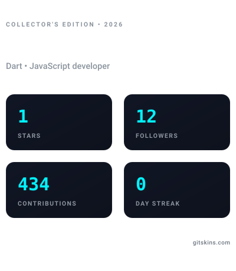
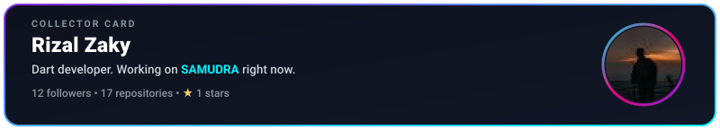
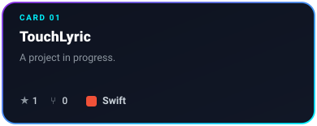
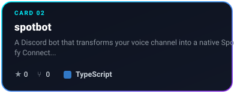
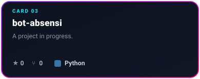
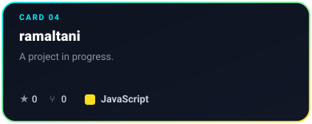
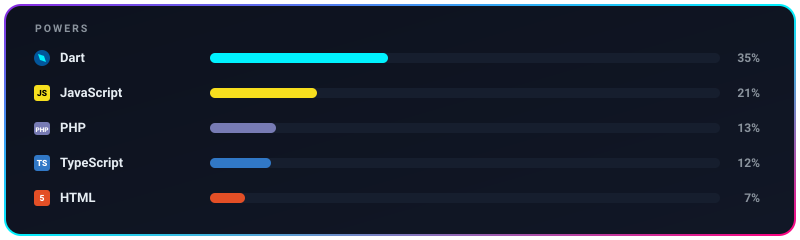

  <!-- TOP SECTION: Animated Collector Card + Stats Panel -->
  
  &nbsp;&nbsp;
  

   

  <!-- MIDDLE SECTION: Collector Card Bio Banner -->
  

    

  <!-- PROJECTS SECTION: 2x2 Interactive Repository Cards -->
  
  &nbsp;
  
   
  
  &nbsp;
  

    

  <!-- BOTTOM SECTION: Powers / Language Breakdown -->
  

